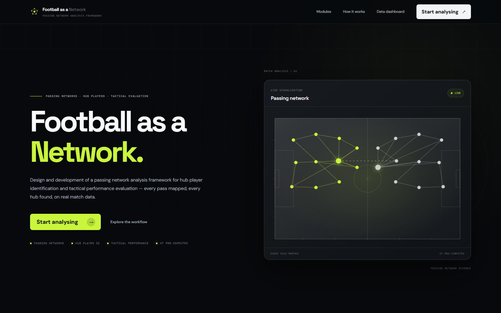
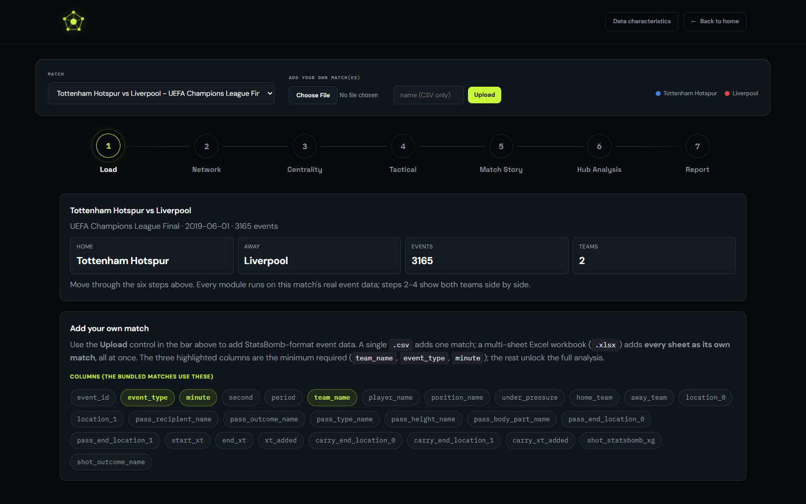
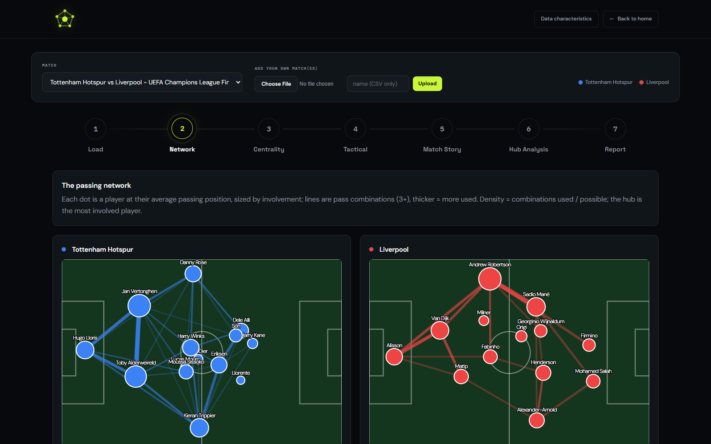
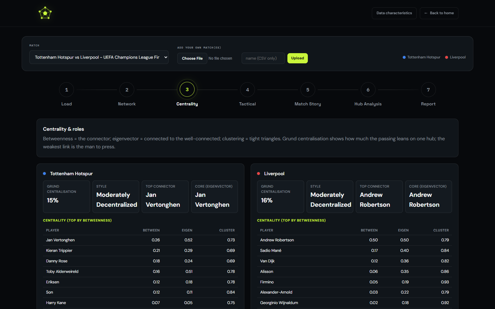
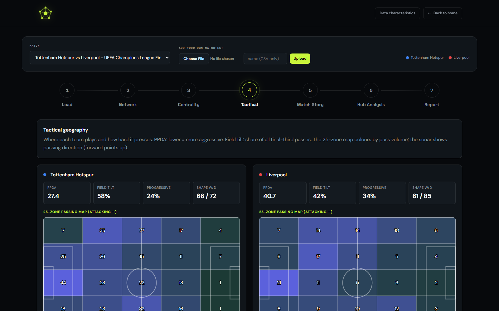
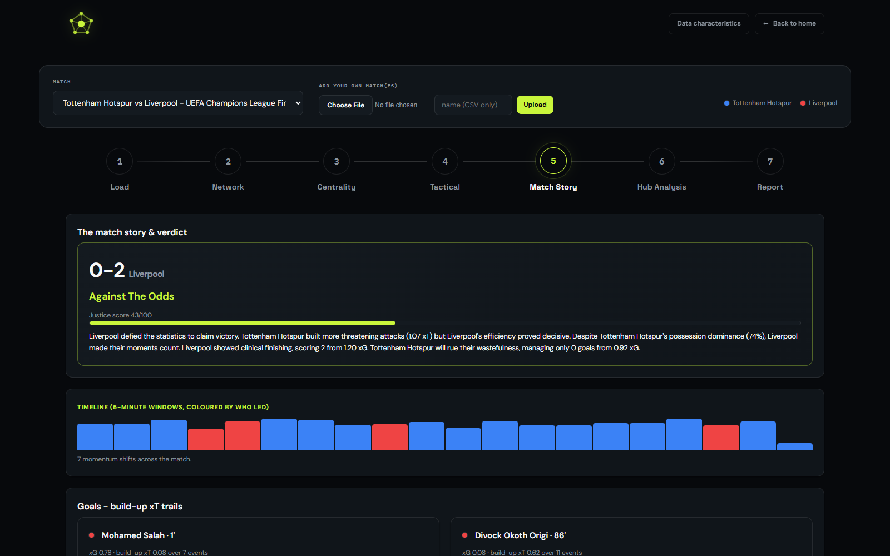
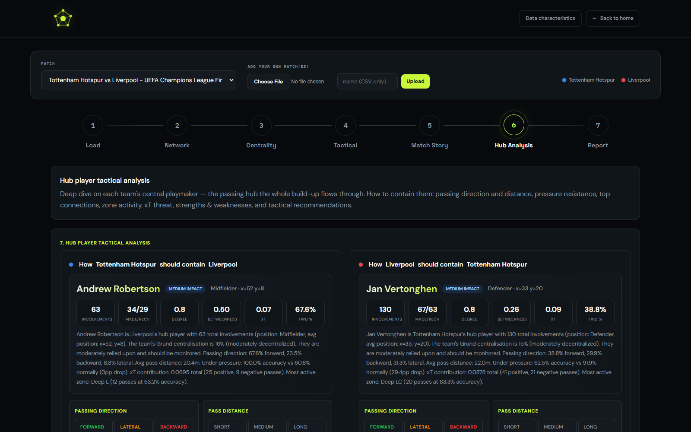
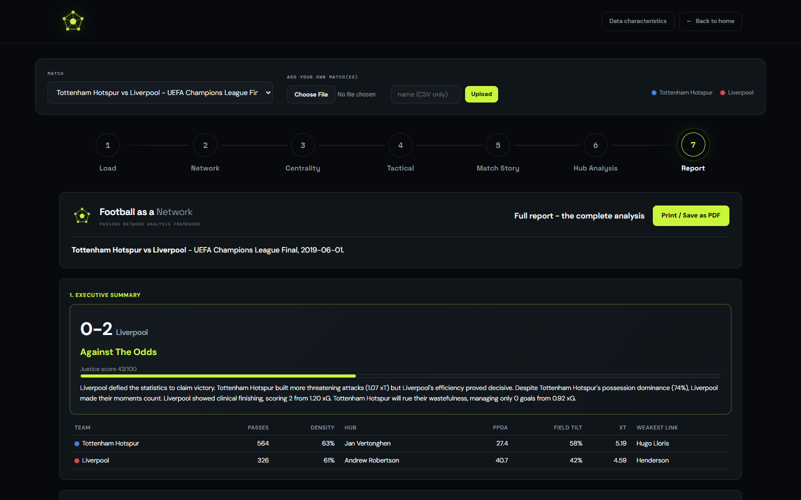
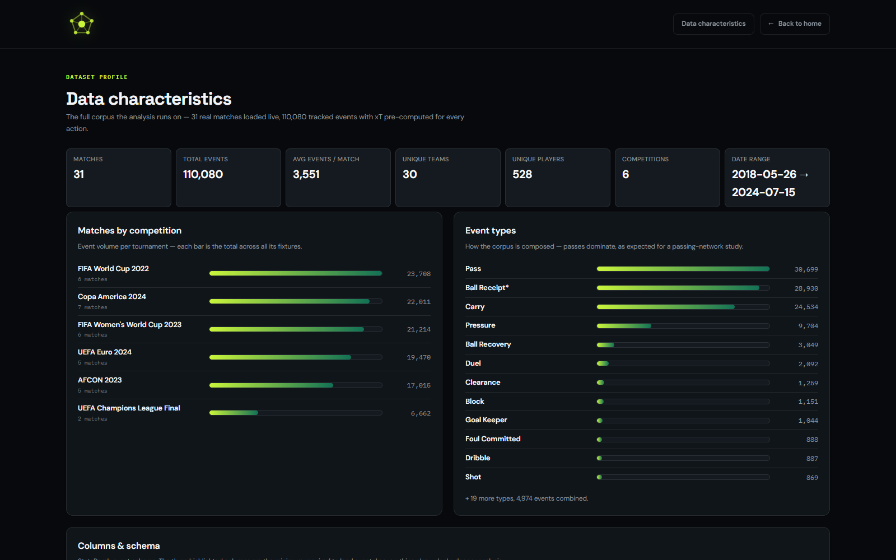

# Football as a Network

**Design and development of a passing network analysis framework for hub player identification and tactical performance evaluation.**

Build and analyse a complete passing network from real match event data, end to end: network construction, centrality and roles, tactical geography, the match story, a hub-player deep dive, and a printable report — all from a local, deterministic engine running on StatsBomb-format events.



## Overview

Every pass in a football match creates a relationship between two players. Treat those relationships as edges in a graph and the team becomes a network — one with hubs, brokers, dense cores and fragile links. This project turns that idea into a working analysis tool.

Given a match's event data, the framework:

- builds a passing network for both teams from completed pass combinations;
- identifies each team's **hub** — the player the whole build-up flows through;
- measures **degree, betweenness, eigenvector and clustering centrality**, plus the **Grund centralisation index**;
- finds the **weakest link** (the man to press) in the opponent's circulation;
- maps **tactical geography** — a 25-zone passing map, passing-direction sonar, zone flow, PPDA, field tilt and team shape;
- reconstructs the **match story** — a 5-minute timeline, momentum shifts, goal build-up xT trails and shot maps;
- delivers a **hub-player tactical analysis** with containment recommendations for each hub;
- produces a **print-ready report** that saves to PDF.

## Screenshots

| | |
|---|---|
|  **Load** — 31 bundled matches, or upload your own CSV / multi-sheet Excel workbook |  **Network** — both teams' passing networks with density and the hub |
|  **Centrality** — Grund centralisation, style, top connector, core, weakest link |  **Tactical** — PPDA, field tilt, team shape, 25-zone passing maps |
|  **Match Story** — timeline, verdict and justice score, goal build-up trails |  **Hub Analysis** — how each side should contain the other's hub |
|  **Report** — the whole analysis as a printable document |  **Data dashboard** — dataset characteristics and coverage |

## The workflow

1. **Load** — pick one of the 31 bundled matches, or upload your own.
2. **Network** — both teams' passing networks on the pitch, with density, the hub and a per-player table.
3. **Centrality** — betweenness / eigenvector / clustering, Grund centralisation, and the weakest link for each team.
4. **Tactical** — 25-zone passing map, direction sonar, zone flow, PPDA, field tilt and team shape.
5. **Match Story** — the 5-minute timeline coloured by who led, the verdict (justice score), goal build-up xT trails and shot maps.
6. **Hub Analysis** — a deep dive on each hub: passing direction and distance, pressure resistance, top connections, zone activity, xT threat, strengths, weaknesses and containment advice.
7. **Report** — a print-ready summary; **Print / Save as PDF** exports it.

## Quick start

### 1. Backend (engine + API)

```bash
cd Backend
pip install -r requirements.txt
python api_server.py
```

The server comes up at **http://localhost:8000** and also serves the standalone vanilla UI. The first start takes roughly 20 seconds while it loads the 31 matches from the Excel datasets; after that it is instant. The console prints the link when ready.

### 2. React front-end

In a second terminal:

```bash
cd react-frontend
npm install
npm run dev
```

Open **http://localhost:5173**. Vite proxies `/api` to the backend at port 8000, so both must be running.

> The standalone UI at `http://localhost:8000` uses only `Backend/main.html`, `style.css` and `script.js` and needs no Node toolchain.

## Adding your own match

Use the **Upload** control in the top bar to add StatsBomb-format event data:

- a single **`.csv`** adds one match;
- a multi-sheet **`.xlsx`** adds **every sheet as its own match** at once.

The minimum required columns are `team_name`, `event_type` and `minute`. The rest of the StatsBomb schema (player names, pass recipients, locations, `xt_added`, …) unlocks the full analysis. If a file has no `xt_added` column it is filled with 0, so the timeline and verdict still run. The Load step lists the exact columns the bundled matches use as a reference.

## Architecture

```
Backend/
├── api_server.py              FastAPI server: loads data once, exposes the engine over HTTP
├── predict_server.py          The analysis engine — fourteen deterministic modules
├── main.html, style.css, script.js   Standalone browser UI
├── champions_league_finals_with_xt.xlsx   2 CL finals, xT pre-computed
├── additional_matches_with_xt.xlsx        29 more matches, xT pre-computed
├── requirements.txt           fastapi, uvicorn, pandas, numpy, openpyxl
├── MODEL_CARD.md              Intended use, metrics, limitations, ethics
├── modules_explained.md       A tour of the engine's modules
└── build_modules_pdf.py       Renders the module tour to PDF

react-frontend/
├── src/
│   ├── api.js                 API layer + response cache
│   ├── App.jsx                Step orchestration
│   ├── components/            Pitch, NetworkSVG, HeatmapSVG, SonarChart, ...
│   └── steps/                 Load, Network, Centrality, Tactical, Story, Hub, Report
└── vite.config.js             Dev server with /api proxy to :8000
```

The React front-end is a presentation layer only. All analysis lives in `predict_server.py`; `api_server.py` imports it unchanged and exposes each module through a single endpoint.

## API

The browser posts a single endpoint for everything:

```http
POST /api/predict
{ "command": "network", "match_date": "2019-06-01", "team": "Liverpool" }
```

Valid commands: `matches`, `teams`, `network`, `insights`, `tactical`, `tactical_map`, `zone_directions`, `zone_connections`, `timeline`, `goals`, `shots`, `compare`, `player`, `health`.

Uploads use `POST /api/upload` with either `csv_text` (plus optional `match_name`) or `xlsx_b64`.

## The fourteen modules

Network construction, basic metrics, degree / betweenness / eigenvector / clustering centrality, Grund centralisation, weakest link, PPDA, field tilt, team shape, pass sequences, timeline & momentum, and the match verdict + narrative. They all live in `predict_server.py`.

## Data

The dataset is **31 real matches** in StatsBomb format — **110,080 events** — with a pre-computed expected-threat value for every action:

- the **2018 and 2019 Champions League finals**;
- **29 knockout matches**: 6 from the 2022 World Cup, 5 from Euro 2024, 7 from the 2024 Copa América, 6 from the 2023 Women's World Cup and 5 from AFCON 2023.

That spans six competitions, three confederations, and both the men's and women's international game. Every analysis is reproducible from the bundled workbooks and the source code.

## Results (thesis evaluation)

The framework is deterministic rather than trained, and was evaluated on all 31 matches (62 team analyses):

- A hub was identified without error in **all 62 team analyses**.
- The hub was in the top three on **eigenvector centrality in 61/62**, betweenness in 55/62 and degree in 44/62.
- The most centralised side (Switzerland, Grund index 25.94%) also had the most involved hub (Granit Xhaka, 227 involvements) — internal consistency.
- **None of the 62 hubs was a forward**: 25 defenders, 37 midfielders. The hub is consistently a deep build-up connector.
- Winners had the higher passing accuracy in 16/31 matches; the higher-tempo side won 18/31.

Because the system is descriptive and single-match, outputs are point estimates — not causal claims. See [`Backend/MODEL_CARD.md`](Backend/MODEL_CARD.md) for intended use, limitations, and ethical considerations.

## Tech stack

- **Backend:** Python, FastAPI, Uvicorn, pandas, NumPy, openpyxl
- **Front-end:** React 19, Vite, hand-built SVG pitch and network visualisations
- **Data:** StatsBomb-format event data with pre-computed expected threat (xT)
- **Model:** deterministic analytical engine (no training, no ML inference)

## Limitations

- Descriptive and single-match; no statistical inference.
- Evaluated only on elite international knockout matches — league play and other event-data formats are untested.
- Event data only: no tracking data, so off-ball movement and pressing shape are approximated.
- Six women's matches in the dataset, so representation there is limited.
- The redistribution licence of the bundled match data is undocumented; please check before reusing it.

## License

No licence file is currently included. Until one is added, the code and bundled data are provided for academic and personal use; please contact the maintainer before redistributing.

## Author

**Samar Singh Bist** — [@SAMAR1007](https://github.com/SAMAR1007)

Questions, bugs or feedback: please [open an issue](https://github.com/SAMAR1007/Football-as-a-Network-Passing-Network-Analysis/issues). The framework is open and deterministic, so any reported number can be independently recomputed from the code and the bundled events.
